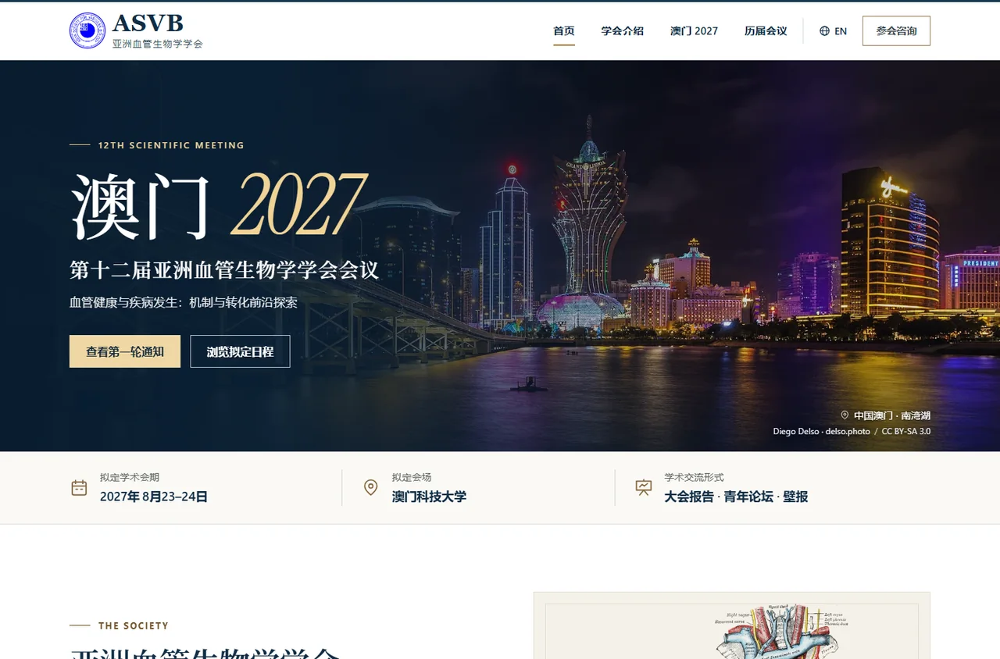

# ASVB · 亚洲血管生物学学会

亚洲血管生物学学会的中英文学术门户。首页介绍学会及拟在澳门举行的第十二届学术会议，并收录新加坡第十一届和深圳第十届会议回顾。



首页澳门夜景由 [Diego Delso](https://delso.photo/) 摄影。[原作](https://commons.wikimedia.org/wiki/File:Lago_Nam_Van,_Macao,_2013-08-08,_DD_04.jpg)采用 [CC BY-SA 3.0](https://creativecommons.org/licenses/by-sa/3.0/) 许可。

## 浏览

下载或克隆仓库后，用浏览器打开 [中文首页](dist/index.html) 或 [English home](dist/en/index.html)。图片、字体、脚本、参会意向表、摘要模板和会前日程均随网站提供。查看资料出处和图片许可，请打开 [资料与图片](dist/sources.html)。

本机预览可在仓库根目录运行下列命令，然后在浏览器中访问 <http://127.0.0.1:8000/>。

```console
python -m http.server 8000 --bind 127.0.0.1 --directory dist
```

## 内容维护

- `content.mjs` 保存两届会议回顾、学会沿革及公开资料链接。
- `build.mjs` 生成两种语言的 HTML 和第十二届会议的日历文件。修改后在仓库根目录运行 `node build.mjs`，将更新后的 `dist` 一并提交。
- `dist/site.css` 和 `dist/site.js` 分别管理排版和导航。`dist/assets` 保存本地图片、字体及许可证，`dist/downloads` 保存可下载的参会材料。
- 第十二届采用第一轮通知的拟定日程和收费口径。更新会期时，同时检查页面、日历和下载附件。第十一届回顾中的统计采用会后报道，下载的 PDF 保留会前日程。

`dist` 目录可以作为静态网站根目录，包含所有运行所需的文件。
